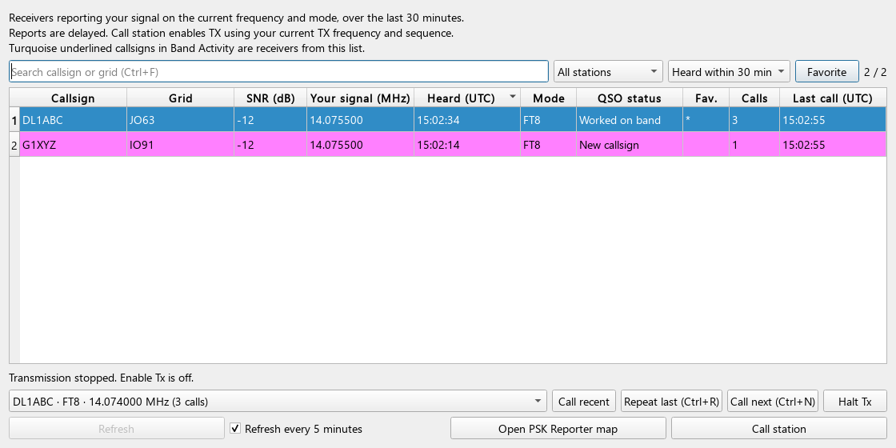

# OE3SRO Custom

**Deutsch** | [English](README.en.md)

**build by OE3SRO**

[](https://github.com/rudolfstepan/wsjtx/actions/workflows/custom-windows.yml)

**[Windows-Release herunterladen](https://github.com/rudolfstepan/wsjtx/releases/latest)** —
das **windows-x64.zip** enthält die Anwendung und die deutsche/englische
Anleitung. Vollständig entpacken und **Start-WSJT-X.bat** öffnen.
Die [Anleitung](docs/WINDOWS-QUICKSTART.html) liegt im Paket unter **docs/index.html**;
sie ist auch separat als **documentation.zip** verfügbar.

**[Neueste CI-Builds](https://github.com/rudolfstepan/wsjtx/actions/workflows/custom-windows.yml):**
Den neuesten erfolgreichen Lauf öffnen und unter **Artifacts** das versionierte
`wsjtx-OE3SRO-…-windows-x64`-Paket herunterladen. GitHub-Anmeldung erforderlich.
Das Artefakt und das darin enthaltene ZIP entpacken, dann **Start-WSJT-X.bat**
starten. EXE, Decoder, DLLs und Stationsdaten sind enthalten. Beim ersten Start
die Station und das Funkgerät einrichten; vorhandene Custom-Einstellungen bleiben
erhalten. Die Downloads werden 90 Tage aufbewahrt.

**Start per Doppelklick:** [start.bat](start.bat) im Projektordner öffnen.
Sie startet das vorhandene Custom-Paket mit dem Profil `Custom`.

Dieser [Fork](https://github.com/rudolfstepan/wsjtx) von
[WSJTX/wsjtx](https://github.com/WSJTX/wsjtx) ergänzt WSJT-X um eine integrierte
PSK-Reporter-Empfängerliste und praktische Anrufhilfen. Du siehst direkt in der
App, welche Stationen dein Signal gemeldet haben, erkennst ihren Logbuchstatus
und kannst sie auswählen oder erneut anrufen.

Die Custom-Erweiterungen stammen von **OE3SRO**; FT2 wurde aus der
GPLv3-Implementierung von **DG2YCB / WSJT-X Improved** adaptiert. Die Versionsanzeige, der Fenstertitel,
das About-Fenster und der Splashscreen tragen den Zusatz **build by OE3SRO**.
Der Custom-Build basiert derzeit auf **WSJT-X 3.0.2-devel**; die hier
beschriebenen Build-Skripte und Paketprüfungen sind für Windows ausgelegt.
GitHub Actions baut dieses Paket automatisch bei jedem Push, einschließlich
Tags, sowie für Pull Requests und manuelle Starts. Der Dateiname enthält die
Projektversion, den Quellcommit, die Buildnummer und den Wiederholungsversuch;
`build-info.json` und eine SHA256-Datei dokumentieren den Download.
Release-Tags `oe3sro-vX.Y.Z-N` veröffentlichen nach erfolgreichen Prüfungen
zusätzlich ein dauerhaftes GitHub-Release mit beiden ZIPs und Prüfsummen.

Die [Änderungshistorie des Forks](docs/CHANGES.md) dokumentiert die Custom-
Erweiterungen und ihre Implementierungscommits. Die [FT2-Dokumentation](docs/FT2.md)
enthält Bedienung, technische Umsetzung, Quellen und den geprüften Buildstand.

## Neue Funktionen von OE3SRO

| Funktion | Nutzen |
| --- | --- |
| **FT8 / FT4 / FT2: native Kerne und TX-Diagnose** | C++-Wellenformen, gemeinsamer LDPC-Encoder, FT8-BP-Kerne und parallele FT4-/FT2-Synchronisationssuche; Audio-/Start-/ALC-Anzeige unter View → TX quality — FT8 / FT4 / FT2. [FT8](docs/FT8.md), [FT4/FT2](docs/FT2.md). |
| **FT2 (experimentell)** | 3,75-Sekunden-Durchgänge mit Sender, Decoder, Auto Seq, Wasserfall und PSK-Anrufhilfen; übernommen und angepasst aus WSJT-X Improved von DG2YCB. |
| **PSK Reporter: Who hears me?** | Empfänger des eigenen Signals direkt in WSJT-X anzeigen, mit Rufzeichen, Locator, SNR, Empfangszeit und Modus. |
| **Station direkt anrufen** | Rufzeichen und Locator übernehmen, die erste Standardnachricht wählen und **Enable Tx** aktivieren. |
| **Empfangsmarkierung in Band Activity** | Rufzeichen aus der Empfangsliste erscheinen türkis, fett und unterstrichen; ein Tooltip zeigt die Empfangszeit. |
| **Bestehende WSJT-X-Farben** | Die Liste verwendet deine Hervorhebungsregeln und das Logbuch, einschließlich Band, Modus, DXCC, Locator und LoTW. |
| **Gespeicherte Favoriten** | Häufig gewünschte Stationen markieren und die Empfangsliste auf Favoriten filtern. |
| **Letzte Anrufe und Wiederanruf** | Die letzten 20 Einträge wieder auswählen oder die zuletzt angerufene Station mit einem Tastenkürzel erneut rufen. |
| **Nächste Station** | Unter den sichtbaren Stationen bevorzugt eine auswählen und anrufen, die im aktuellen Frequenz-/Moduskontext hier noch nicht angerufen wurde. |
| **Suche und Filter** | Nach Rufzeichen oder Locator suchen; neue Rufzeichen, neu auf diesem Band, Favoriten, bereits angerufene Stationen oder Meldungen der letzten 5/15/30 Minuten anzeigen. |
| **Anrufübersicht und Halt Tx** | Anrufversuche und letzte Anrufzeit sehen; die Aussendung direkt aus der Liste stoppen. |
| **Konfiguration übernehmen** | Die installierte WSJT-X-Konfiguration bytegenau in ein eigenes Custom-Profil kopieren, mit lokalen Stationsdaten und Logbuch. |



*Beispielansicht mit Testdaten. Die tatsächlichen Zeilenfarben richten sich
nach deinen WSJT-X-Einstellungen.*

## FT2 verwenden

Wähle **Mode → FT2**. Die App verwendet 3,75-Sekunden-TX/RX-Perioden,
die bekannten Standardnachrichten und Auto Seq. FT2-Decodes sind mit `*`
markiert. Bestehende Einstellungen bleiben erhalten; nur FT2-Frequenzvorgaben
werden einmalig ergänzt, sofern noch keine eigenen FT2-Einträge existieren.

Die Integration basiert auf [WSJT-X Improved / WS Suite](https://wsjt-x-improved.sourceforge.io/)
von **Uwe Risse, DG2YCB** (GPLv3). FT2 bleibt experimentell. Sender/Decoder
wurden mit WAV-Roundtrips und zwei offiziellen FT2-Aufnahmen geprüft;
der echte Funkbetrieb wurde nicht getestet. Details und Quellen:
[FT2-Dokumentation](docs/FT2.md).

## Bedienung

Öffne **View → PSK Reporter — Who hears me?**. Die Ansicht fragt
Empfangsmeldungen für dein konfiguriertes Rufzeichen im aktuellen Modus ab.
Modus und Band stammen direkt aus der laufenden Anwendung. Sie berücksichtigt
die letzten 30 Minuten im aktuellen Band; **Current frequency and mode**
beschränkt die Anzeige optional auf Dialfrequenz bis 5 kHz darüber.
Pro Empfänger erscheint die neueste Meldung.
Eine neue Abfrage ist frühestens nach fünf Minuten möglich; die automatische
Aktualisierung arbeitet bei geöffneter Ansicht.
Die Refresh-Schaltfläche zeigt die Wartezeit; Abfragefehler löschen vorhandene
Meldungen nicht. Direkte Anrufe und Band-Activity-Markierungen bleiben auf den
aktuellen Arbeitsbereich beschränkt.

Die Spalte **QSO status** zeigt **New callsign**, **Worked** oder
**Worked on band**. Farben und Logbuchfilter aktualisieren sich auch nach
einem neuen Logbucheintrag oder geänderten Hervorhebungsregeln.

### Eine Station anrufen

1. Wähle eine Station in der Liste aus.
2. Klicke **Call station**, drücke **Ctrl+Enter** oder doppelklicke die Zeile
   außerhalb der Favoritenspalte.
3. Die App übernimmt Rufzeichen und Locator, wählt **Tx1** und aktiviert
   **Enable Tx**. Der Anruf wird im nächsten eingestellten TX-Zeitfenster
   gesendet, mit deiner eingestellten TX-Frequenz und TX-Sequenz.

Das direkte Anrufen unterstützt **FT2, FT8, FT4, JT65, JT9 und Q65** im normalen
QSO-Betrieb mit aktivem Tx1. Während einer laufenden Aussendung, bei Tune,
Dateiwiedergabe oder einer speziellen Betriebsaktivität zeigt die Ansicht
den Hinderungsgrund. Nach einem Wechsel des eigenen Rufzeichens, des Modus
oder der Dialfrequenz muss die Empfangsliste vor einem Anruf aktualisiert werden.

Empfangsmeldungen sind verzögert: Sie zeigen, dass eine Station dein Signal
empfangen hat. Sie enthalten keine verlässliche Sendefrequenz oder TX-Sequenz
des Empfängers und bestätigen keine aktuelle QSO-Bereitschaft.
**Open PSK Reporter map** öffnet zusätzlich die
[PSK-Reporter-Karte](https://www.pskreporter.info/pskmap.html) im Browser.

### Häufiger und gezielter anrufen

- **Favorite** markiert die ausgewählte Station dauerhaft. Ein `*` in
  **Fav.** kennzeichnet sie. Ein Doppelklick in diese Spalte schaltet die
  Markierung um. Der Filter **Favorites** zeigt gespeicherte Favoriten, die
  in der aktuellen Empfangsliste stehen.
- **Call recent** ruft den ausgewählten Eintrag aus der Anrufhistorie erneut
  auf. **Repeat last** wiederholt den letzten Anruf, auch ohne aktuelle
  Empfangsmeldung. Eigenes Rufzeichen, Modus und Dialfrequenz müssen dabei
  zum gespeicherten Anruf passen.
- **Call next** berücksichtigt die aktuellen Filter und die Sortierung.
  Bevorzugt wird eine im aktuellen Kontext noch nicht angerufene Station.
  Jeder Klick startet einen einzelnen Anruf.
- **Calls** zählt hier gestartete Anrufversuche; **Last call (UTC)** zeigt
  deren letzten Startzeitpunkt. Erfolgreiche QSOs werden über den
  Logbuchstatus angezeigt.
- **Halt Tx** führt denselben Stopp wie im Hauptfenster aus.

Favoriten und Anrufhistorie bleiben im jeweiligen Konfigurationsprofil nach
einem Neustart erhalten. Empfangsmarkierungen in **Band Activity** verschwinden
nach einem Rufzeichen-, Modus- oder Frequenzwechsel sowie spätestens 30 Minuten
nach der zugehörigen Meldung.

### Tastenkürzel im PSK-Fenster

| Tastenkürzel | Aktion |
| --- | --- |
| **Ctrl+F** | Suche öffnen/fokussieren |
| **Ctrl+Enter** | Ausgewählte Station anrufen |
| **Ctrl+R** | Letzte Station erneut anrufen |
| **Ctrl+N** | Nächste passende Station anrufen |
| **Ctrl+Shift+S** | Halt Tx |

## Unter Windows bauen

Die Skripte erwarten **MSYS2/MinGW64 unter `C:\msys64\mingw64`** mit
CMake, Ninja, GCC/G++, Fortran, Qt5, Boost, FFTW und libusb. Qt muss die
Komponenten Widgets, Network, Multimedia, PrintSupport, SerialPort, Sql,
WebSockets, ActiveQt, SVG und die Qt-Werkzeuge bereitstellen.

`Setup-CustomBuild.ps1` lädt das **Hamlib-4.7.2-SDK** mit SHA256-Prüfung sowie
die auf Commit und SHA256 festgelegte OmniRig-Typbibliothek in das lokale
Verzeichnis `.tools`. `WSJTX_MINGW_PREFIX` kann den Standardpfad überschreiben.
MSYS2 und seine
Pakete müssen bereits installiert sein.

Führe im Repository-Verzeichnis aus:

```powershell
.\tools\Setup-CustomBuild.ps1
.\tools\Build-Custom.ps1
.\tools\Test-Core.ps1
.\tools\Test-TxQuality.ps1
.\tools\Test-PskReporter.ps1
.\tools\Test-Ft2.ps1
.\tools\Package-Custom.ps1
```

Der Release-Build liegt unter `build-custom`; das Paket mit Laufzeitbibliotheken,
Decodern und Stationsdaten unter `dist-custom\OE3SRO-ftx-native`.
Die Skripte bauen WSJT-X mit den zugehörigen Hilfsprogrammen; MAP65 und die
zusätzlichen Simulatoren werden für dieses Paket nicht gebaut.

### Bestehende Konfiguration übernehmen und starten

Vor dem **ersten** Start kannst du deine installierte WSJT-X-Konfiguration
in das Custom-Profil übernehmen:

```powershell
.\tools\Copy-InstalledConfiguration.ps1
.\Start-Custom.ps1
```

Der Import liest `%LOCALAPPDATA%\WSJT-X\WSJT-X.ini` und erstellt
`%LOCALAPPDATA%\WSJT-X - Custom\WSJT-X - Custom.ini`. Die INI wird bytegenau
kopiert und per SHA256 geprüft. Gespeicherte Konfigurationen, Einstellungen
und Dateipfade bleiben erhalten; vorhandene Stationsdaten und Logbücher
werden ebenfalls kopiert. Eine private Sicherung liegt unter `.local`.
Existiert das Custom-Profil bereits, bricht der Import ab und bewahrt es.

`Start-Custom.ps1` startet das Paket mit `--rig-name Custom`. Bei späteren
Starts genügt dieses Skript. Beende eine noch laufende ältere Custom-Version
normal, bevor du das neue Paket startest.

Weitere Einzelheiten stehen in [CUSTOM-BUILD.md](CUSTOM-BUILD.md).
Lokale Konfigurationen, API-Antworten, Werkzeuge und Build-Ausgaben unter
`.local`, `.tools`, `build-custom` und `dist-custom` werden nicht in Git übernommen.

## Prüfungen

`Test-Core.ps1` prüft ADIF-Einträge am Dateiende, die UDP-Zielinstanz und
Serverwechsel während einer laufenden DNS-Abfrage mit lokalen Testdaten.

`Test-PskReporter.ps1` verwendet einen lokalen HTTP-Testserver und Qt im
Offscreen-Modus. Geprüft werden unter anderem Empfangsfilter, neueste Meldung
je Station, Abfrageintervall, fehlerhafte XML-Antworten, Farben und Logbuchstatus,
Band-Activity-Markierungen, Favoriten und gespeicherte Anrufe, Wiederanruf im
passenden Kontext, nächste Station und der Halt-Tx-Callback. Dabei wird keine
Funkübertragung ausgelöst.

Ohne Originalinstallation oder importierte Konfiguration prüfst du die
Paketlaufzeit mit:

```powershell
.\tools\Verify-CustomPackage.ps1 -PortableOnly
```

Das erste [Release 3.0.2-oe3sro.1](https://github.com/rudolfstepan/wsjtx/releases/tag/oe3sro-v3.0.2-1)
bestand den vollständigen CI-Build einschließlich PSK-, FT2-/FT4- und
Paketprüfungen. Die öffentlichen ZIP-Downloads und Prüfsummen wurden geprüft.

Nach dem Konfigurationsimport lässt sich das Paket zusätzlich prüfen:

```powershell
.\tools\Verify-CustomPackage.ps1
```

Diese lokale Prüfung kontrolliert die Paketlaufzeit, OpenSSL und den Erhalt
der Custom-Konfiguration. Für den Versionsvergleich erwartet das Skript die
Originalinstallation unter `C:\WSJT\wsjtx\bin\wsjtx.exe`.

## Grundlage und Danksagung

Die Erweiterungen bauen auf der Arbeit des **WSJT Development Team** und
aller Mitwirkenden an WSJT-X auf. Empfangsdaten kommen von
[PSK Reporter](https://www.pskreporter.info/pskdev.html). Die Stationsfilter
orientieren sich an der
[GridTracker Call Roster](https://docs.gridtracker.org/latest/Making-GridTracker-Work-For-You/Using-Call-Roster.html).

Die folgende Beschreibung des Originalprojekts sowie die Lizenz- und
Markenhinweise sind auch in der englischen README enthalten.

---

## Software für Schwachsignal-Kommunikation — Originalprojekt

### Programme

*WSJT-X*, *MAP65* und *QMAP* sind quelloffene, plattformübergreifende Programme
für digitale Schwachsignal-Kommunikation im Amateurfunk. *WSJT-X* arbeitet mit
einem normalen SSB-Transceiver, während *MAP65* und *QMAP* breitbandige
SDR-Hardware verwenden. Die Programme sind kostenlos und unter der GNU General
Public License lizenziert.

*WSJT-X* unterstützt die Betriebsarten **FST4**, **FST4W**, **FT4**, **FT8**,
**JT4**, **JT9**, **JT65**, **MSK144**, **Q65**, **WSPR** und **Echo**. Die ersten
neun Betriebsarten ermöglichen zuverlässige, bestätigte QSOs unter verschiedenen
Schwachsignal-Ausbreitungsbedingungen. Sie verwenden mit UTC synchronisierte
Sende- und Empfangssequenzen bestimmter Länge. **WSPR** untersucht mögliche
Ausbreitungswege mit geringer Sendeleistung; **Echo** erkennt und misst
Reflexionen des eigenen Signals vom Mond.

*MAP65* ist ein breitbandiger Empfänger für **JT65** und **Q65**, optimiert
für EME auf VHF und UHF. Es arbeitet mit *Linrad* von SM5BSZ oder direkt mit
einer Soundkarte, einem FUNcube Dongle oder ähnlicher Hardware. Das Programm
decodiert alle **JT65**- oder **Q65**-Signale in einem bis zu 90 kHz breiten
Durchlassbereich und erzeugt eine sortierte Bandübersicht der Rufzeichen.
Bei Systemen mit zwei Polarisationen passt es den linearen Polarisationswinkel
jedes Signals optimal an und gleicht damit Faraday-Rotation und räumliche
Polarisationsunterschiede aus. Es übernimmt auch die Sende-/Empfangsumschaltung
und erzeugt Nachrichten und Audiosignale für die gewählte Betriebsart.

*QMAP* ermöglicht ähnlich wie *MAP65* den breitbandigen Empfang eines gesamten
EME-Teilbands. Zusammen mit *WSJT-X* unterstützt es **Q65** mit 30- und
60-Sekunden-Sequenzen. Die Kombination bietet Transceiversteuerung und
Dopplerkompensation für den Erde-Mond-Erde-Signalweg.


### Einzelheiten zu den Betriebsarten

**JT4**, **JT9** und **JT65** verwenden nahezu identische Nachrichtenstrukturen,
effiziente Kompression für minimale QSOs und 60-Sekunden-Sende-/Empfangssequenzen.
**JT4** und **JT65** wurden für EME auf VHF, UHF und den Mikrowellenbändern
entwickelt, **JT9** ist für MF und HF optimiert. **JT9** ist etwa 2 dB
empfindlicher als **JT65** und benötigt weniger als 10 % seiner Bandbreite.

**FT4** und **FT8** verwenden Zyklen von nur 7,5 beziehungsweise 15 Sekunden
und sind für weltweite DX-Verbindungen auf HF weit verbreitet. **MSK144**
ist für Meteorscatter auf VHF ausgelegt. **Q65** bietet Sequenzlängen von
15 Sekunden bis 5 Minuten und verschiedene Tonabstände. Geeignete Q65-Varianten
eignen sich besonders für EME, ionosphärische Streuung und andere
Schwachsignal-Verbindungen auf VHF, UHF und den Mikrowellenbändern. Diese
Betriebsarten unterstützen auch nicht standardmäßige Rufzeichen und
Nachrichtenformate für einige verbreitete Amateurfunkwettbewerbe.

**FST4** und **FST4W** wurden besonders für LF und MF entwickelt. Auf diesen
Bändern erreichen sie bei gleicher Sequenzlänge eine höhere Empfindlichkeit
als andere *WSJT-X*-Betriebsarten und nähern sich den theoretischen Grenzen
ihrer Datenrate. **FST4** ist für Zweiweg-QSOs optimiert, **FST4W** für
bakenähnliche Aussendungen von Nachrichten im **WSPR**-Stil. Beide benötigen
nicht die strenge unabhängige Zeitsynchronisation und Phasenbindung von
Betriebsarten wie EbNaut.


### Lizenz

Lizenziert unter der GNU General Public License v3.0 — siehe [COPYING](COPYING).

### Marken

„WSJT-X“, „MAP65“ und „QMAP“ sind Marken des WSJT Development Team. Die
Richtlinie zur Verwendung dieser Namen steht in [TRADEMARK.md](TRADEMARK.md).
