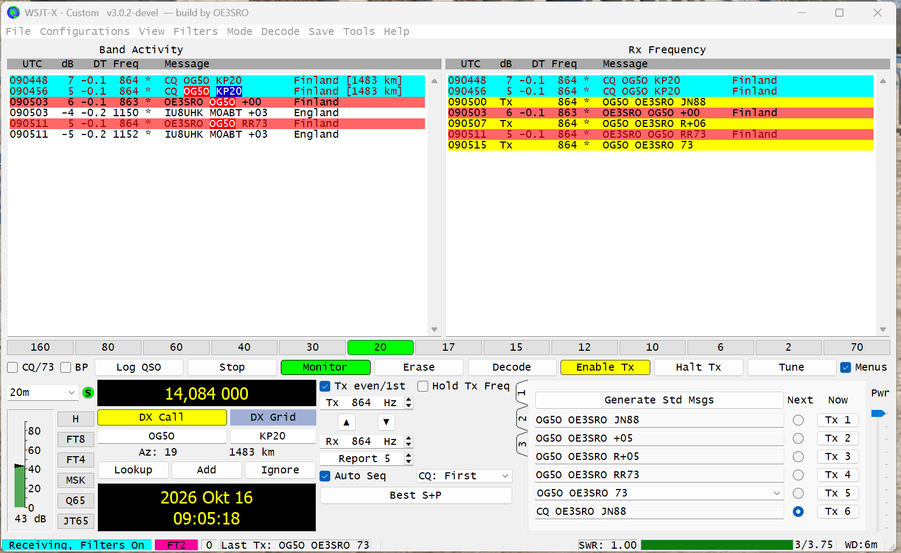

# FT2 in OE3SRO Custom

[README Deutsch](../README.md) | [README English](../README.en.md) |
[Änderungshistorie / Change history](CHANGES.md)

## FT2-Praxisnachweis / On-air evidence — 2026-10-16

Der von OE3SRO bereitgestellte Original-Screenshot dokumentiert ein erfolgreiches
FT2-QSO mit **OG5O, KP20, Finnland**, am **16. Oktober 2026** auf **20 m** bei
**14,084 MHz Dialfrequenz**. Die Anwendung zeigt FT2, 3,75-Sekunden-Perioden,
864 Hz TX-/RX-Audiofrequenz und eine Entfernung von 1483 km. Der Austausch
enthält den empfangenen Rapport, das empfangene **RR73** und das abschließend
gesendete **73**. Damit liegt neben den automatisierten Prüfungen ein vom
Benutzer dokumentierter Nachweis des funktionierenden FT2-Funkbetriebs vor.

**English:** The original screenshot supplied by OE3SRO documents a successful
FT2 QSO with **OG5O, KP20, Finland**, on **16 October 2026**, using **20 m** at
a **14.084 MHz dial frequency**. The application shows FT2, 3.75-second periods,
864 Hz TX/RX audio frequency, and a distance of 1483 km. The exchange includes
the received signal report, received **RR73**, and final transmitted **73**,
providing user-documented evidence of working FT2 operation on air.



Sichtbarer QSO-Ablauf / Visible QSO exchange (UTC):

| UTC | Richtung / Direction | Nachricht / Message |
| --- | --- | --- |
| 09:05:00 | TX | `OG5O OE3SRO JN88` |
| 09:05:03 | RX | `OE3SRO OG5O +00` |
| 09:05:07 | TX | `OG5O OE3SRO R+06` |
| 09:05:11 | RX | `OE3SRO OG5O RR73` |
| 09:05:15 | TX | `OG5O OE3SRO 73` |

Unveränderte Originaldatei / Unmodified original file: 1675 × 1028 px.
SHA256: `d950dc2cc46d4e24859e34d5fa4e8f60fc4631cc42f1877e76d5799862ae463a`.

## Aktuelles Windows-Release / Current Windows release

[3.0.2-oe3sro.4](https://github.com/rudolfstepan/wsjtx/releases/tag/oe3sro-v3.0.2-4)
enthält FT2, die nativen FT8-/FT4-/FT2-Kerne, TX-Diagnose, Fehlerkorrekturen
und die DE/EN-Anleitung. Windows-ZIP
vollständig entpacken und **Start-WSJT-X.bat** öffnen; Anleitung **docs/index.html**.
Im lokalen Repository startet **Start-Custom.ps1** das Paket unter
`dist-custom\OE3SRO-psk-backoff`. Der historische Prüfstand vom 11. Oktober bleibt
weiter unten dokumentiert. FT2 bleibt experimentell.

The release includes FT2, native FT8/FT4/FT2 kernels, TX diagnostics,
bug fixes, and the German/English guide.
Extract the complete Windows ZIP and launch **Start-WSJT-X.bat**; open
**docs/index.html** for instructions. The local repository launcher is
**Start-Custom.ps1**, using `dist-custom\OE3SRO-psk-backoff`. The October 11 baseline
below remains a historical verification record. FT2 remains experimental.

### Historischer Prüfstand des ersten Releases / First-release verification

Der [CI-Lauf von 3.0.2-oe3sro.1](https://github.com/rudolfstepan/wsjtx/actions/runs/38218198831)
bestand PSK-, FT2-/FT4- und eigenständige Paketprüfungen. Release-EXE-SHA256:
The first-release CI passed PSK, FT2/FT4, and standalone runtime checks. EXE SHA256:

```text
F61F611C41E059FBF4BB91CA9BB28502BF179ED88B591F76A47F4739B2EF9DB3
```

## C++- und SMP-Erweiterung für FT4/FT2 — 2026-10-15

Der aktuelle lokale Stand erweitert die FT8-Optimierungen auf FT4 und FT2:

- Gemeinsame GFSK-Wellenformerzeugung in
  [ft8_wave.cpp](../lib/ft8/native/ft8_wave.cpp), jetzt mit separater
  FT4-/FT2-Rampenform (je ein ganzes Rampensymbol, keine FT8-Randverlängerung).
  Zentrierte doppelte Phase, interpolierte Sinustabelle, unveränderlicher
  Pulscache und private Arbeitsarrays. Zu große FT4-Puffer werden nach einer
  kürzeren FT2-Wellenform mit Nullen gefüllt.
- Der native LDPC(174,91)-Encoder wird von allen drei Modi gemeinsam verwendet.
- [ft4_sync.cpp](../lib/ft4/native/ft4_sync.cpp) ersetzt die Leistungsberechnung
  und das Frequenz-/Zeitsuchraster durch C++. Frequenzkorrekturen werden einmal
  je Hypothese berechnet. Größere Raster verteilen sich automatisch auf höchstens
  acht Worker, begrenzt durch CPUs, OpenMP-Threadlimit und aktive Ebenen.
  Kleine Feinsuchen bleiben seriell. Die Ergebnisreduktion hält die bisherige
  Suchreihenfolge einschließlich Gleichständen ein.
- Die lokale Qt-Audioausgabe von FT4 und FT2 erhält eigene Wellenform-Snapshots über die Audio-Queue,
  vollständige Endbegrenzung und die TX-Diagnose unter
  **View → TX quality — FT8 / FT4 / FT2**. Die dortigen FT8-Threadregler
  sind in FT4/FT2 deaktiviert; deren Synchronisationssuche arbeitet automatisch.

Die Subtraktionsdurchläufe, FFT-Verarbeitung, Nachrichtenpackung und
Hybrid-BP/OSD bleiben in ihrer bisherigen Reihenfolge beziehungsweise enthalten
weiter Fortran. Dies ist keine vollständige C++-Portierung des Decoders.

Lokale Kernelmessung auf i9-14900K, GCC15.2 Release, 30 Wiederholungen:
FT4-Wellenform bei 48 kHz etwa 8,6 → 1,0 ms, FT2 etwa 4,2 → 0,4 ms.
Ein geprüftes Synchronisationsraster sank mit acht Workern etwa 0,63 → 0,18–0,21 ms.
Dies sind keine allgemeinen Gesamtdecoder-Speedups; insbesondere bei kleinen
Rastern und wenig belegtem Band kann der Parallelisierungsaufwand überwiegen.

`Test-Ft2.ps1` vergleicht reelle/komplexe Wellenformen bei 12/48 kHz mit den
Originalen und einem analytischen Träger, prüft Cachewechsel, Parallelaufrufe,
Synchronisation an Puffergrenzen, Grob-/Feinsuche und Gleichstände. Eine
FT4-Aufnahme liefert mit alten und neuen Kernen jeweils 19 Nachrichten; die beiden
optionalen FT2-Aufnahmen jeweils sechs und zwei. Alle bestehen mit 1/8 Workern, einem auf zwei
begrenzten Team und deaktivierten Parallelteams. Keine Funkgeräteprüfung.

**English:** The current local build extends the FT8 optimizations to FT4 and
FT2: native GFSK generation with their original full-symbol ramps, centered
double-precision phase, a shared native LDPC encoder, private audio snapshots,
and a native parallel synchronization grid. Large grids use at most eight
workers within CPU/OpenMP limits; fine grids remain serial, preserving the
original peak/tie order. Open **View → TX quality — FT8 / FT4 / FT2** for shared
diagnostics. FT8-specific thread controls are disabled in FT4/FT2.

Recorded differential tests preserve all 19 FT4 and 6/2 FT2 messages across the four
team configurations above. The local waveform timings are about 8.6 → 1.0 ms
(FT4) and 4.2 → 0.4 ms (FT2), not full-decoder speedups. FFT, message packing and
hybrid BP/OSD still contain Fortran. No on-air improvement has been measured.

**Deutsch**

FT2 ist über **Mode → FT2** verfügbar. Der experimentelle Modus verwendet
3,75-Sekunden-TX/RX-Perioden, 77-Bit-Nachrichten, 105 Symbole einschließlich
Rampen, 288 Samples pro Symbol bei 12 kHz und 41,667 Hz Tonabstand.
Die Wellenform dauert 2,52 Sekunden; die Audioausgabe startet nominell
150 ms nach dem Periodenbeginn. Decodes tragen den Marker `*`.

Die Standardnachrichten, Auto Seq, Doppelklick auf Decodes, Logbuch,
Wasserfall und PSK-Reporter-Anrufhilfen unterstützen FT2. PSK Reporter
fragt Meldungen mit `mode=FT2` ab; die Liste hängt von tatsächlich gemeldeten
FT2-Empfängen ab. Ein PSK-Empfang bestimmt weiterhin keine TX-Sequenz des
Empfängers. Beim ersten Start werden ausschließlich fehlende FT2-Vorgaben
ergänzt. Bestehende Frequenzen und selbst angelegte FT2-Einträge bleiben
erhalten; ein vollständiger Frequenz-Reset ist nicht erforderlich.
Die Vorgaben aus der Referenz sind vorläufig und nach Region gefiltert.
Unter **Settings → Frequencies** kannst du eigene FT2-Einträge ergänzen.
Fox/Hound-Betrieb wird beim Wechsel zu FT2 beendet.

Die Integration beruht auf **WSJT-X Improved 3.1.0 PLUS 260522** von
**Uwe Risse, DG2YCB**, heute [WS Suite](https://wsjt-x-improved.sourceforge.io/).
Insbesondere die Empfangsstrategie (Samples verdoppeln und mit dem FT4-Decoder
auswerten), Frequenz-/DT-Umrechnung und Timingparameter wurden daraus übernommen
oder angepasst. Die unabhängige Implementierung wird dort als kompatibel zum
FT2-Modus von IU8LMC beschrieben. Lizenz: **GNU GPLv3**, wie dieses Repository.
Der vorhandene alte experimentelle `lib/ft2`-Codec wird hierfür nicht verwendet.
Der aktuelle native Wellenformgenerator hält unveränderliche Gaussian-Pulse
für unterschiedliche Symbolzeiten getrennt im Cache; Details stehen oben.

Validierung ohne Funkgerät: drei FT2-TX/RX-Roundtrips (500/1500/2900 Hz),
FT4-Regressionsfall, wiederholter FT4/FT2-Wechsel, TX-Sequenzen einschließlich
UTC-Tageswechsel, Erhalt von Frequenzeinträgen und beide unten genannten
offiziellen FT2-Aufnahmen. Sie ergeben sechs bzw. zwei Stationen.
Der oben dokumentierte Benutzer-Screenshot vom 16. Oktober 2026 ergänzt diese
Prüfungen um ein erfolgreiches FT2-QSO im Funkbetrieb. Die Umschaltzeiten eines
konkreten Transceivers wurden nicht separat gemessen.

```powershell
.\tools\Build-Custom.ps1
.\tools\Test-Ft2.ps1
# Optional: beide offiziellen WAVs zuvor in diesen Ordner herunterladen.
.\tools\Test-Ft2.ps1 -SamplesDirectory .local\ft2-reference\samples
```

**English**

Select **Mode → FT2**. This experimental mode uses 3.75-second TX/RX periods,
77-bit messages, 105 symbols including ramps, 288 samples per symbol at
12 kHz, and 41.667 Hz tone spacing. The waveform lasts 2.52 seconds, with
audio nominally starting 150 ms after the period boundary. Decode marker: `*`.

FT2 is supported by standard messages, Auto Seq, double-click calling,
the logbook, waterfall, and PSK Reporter calling tools. PSK Reporter requests
use `mode=FT2`; results depend on actual FT2 reception reports. Receiver
reports do not identify the receiver's TX sequence. First-start migration
adds only missing FT2 defaults, preserving existing frequencies and custom
FT2 entries. No full frequency reset is required. Reference frequencies are
provisional and region filtered; add your own under **Settings → Frequencies**.
Switching to FT2 exits Fox/Hound operation.

The integration adapts **WSJT-X Improved 3.1.0 PLUS 260522** by **Uwe Risse,
DG2YCB**, now [WS Suite](https://wsjt-x-improved.sourceforge.io/), specifically
its time-stretched FT4 receive strategy, frequency/DT conversion, and timing.
Its independently developed implementation is described as compatible with
IU8LMC's FT2. License: **GNU GPLv3**, the same as this repository. The old
experimental codec in `lib/ft2` is not used. The current native waveform
generator caches immutable pulses for different symbol durations separately.

Validation without a radio includes three FT2 TX/RX round trips at 500/1500/2900
Hz, an FT4 regression case, repeated FT4/FT2 switches, reply sequences across
UTC midnight, preservation of user frequencies, and both official FT2 WAVs
below (six and two decoded stations). The user screenshot dated 16 October 2026
above adds evidence of a successful on-air FT2 QSO. Individual transceiver
switching times have not been measured separately. Use the commands above.

## Sources and reproducibility

- [WS Suite / WSJT-X Improved](https://wsjt-x-improved.sourceforge.io/)
- [FT2 description in the developer's guide](https://wsjt-x-improved.sourceforge.io/wsjtx-main_en.html)
- [Source archive: wsjtx-3.1.0_improved_PLUS_260522.tgz](https://sourceforge.net/projects/wsjt-x-improved/files/WSJT-X_v3.1.0/Source%20code/wsjtx-3.1.0_improved_PLUS_260522.tgz/download)
  — SHA256 `F159CDE764ABABB2C63EE8F307F18F29DB0DB322E152622CC5B4E2C7575FB5A0`.
- [Official FT2 WAV samples](https://sourceforge.net/projects/wsjt-x-improved/files/Samples/FT2/)
  — `260301_170123.wav` and `260301_085945.wav`; pinned SHA256 values are in
  [Test-Ft2.ps1](../tools/Test-Ft2.ps1). Reference downloads stay outside Git.

## Technical implementation

Die folgenden Details beschreiben den Quelltext von Commit
[`4c7c48d53`](https://github.com/rudolfstepan/wsjtx/commit/4c7c48d538fcdc58863d3fd38efabcf6c1fa351a).
The following details describe the source at that implementation commit.

### Parameter / Parameters

| Parameter | FT2 |
| --- | --- |
| TX/RX-Periode / TX/RX period | 3.75 s, 16 periods per minute |
| Nutzdaten / Message payload | 77 bits, shared FT4 LDPC(174,91) encoding |
| Modulation | Four-tone GFSK |
| Symbole / Symbols | 103 sync/data symbols plus 2 ramp symbols |
| Samples je Symbol / Samples per symbol | 288 at 12 kHz; 1152 at 48 kHz |
| Tonabstand / Tone spacing | 12000 / 288 = 41.667 Hz |
| Wellenformdauer / Waveform duration | 105 × 288 / 12000 = 2.52 s |
| Audio-Startversatz / Audio start offset | Nominally 150 ms after the period boundary |
| TX-Steuerfenster / TX control window | `tx_duration`: 0.5 + 2.52 = 3.02 s |
| Decode-Marker / Decode marker | `*` |
| Backend-Modus-ID / Backend mode ID | `52` in `jt9` and `decoder.f90` |
| Persistierte Modus-ID / Persisted mode ID | `Modes::FT2 = 13`; existing FT4 = 9, Q65 = 12 unchanged |
| ADIF | `MODE=MFSK`, `SUBMODE=FT2` |

Die 3,02 Sekunden sind das Steuerfenster der App; die erzeugte Audio-Wellenform
ist 2,52 Sekunden lang. The 3.02-second value is the app's control window;
the generated audio waveform lasts 2.52 seconds.

### Deutsch — Datenpfad und Einstellungen

**Sender.** [mainwindow.cpp](../widgets/mainwindow.cpp) verwendet `genft4`
für die gemeinsame Nachrichtenkodierung und `gen_ft4wave` mit 1152 Samples
pro Symbol für die vorab berechnete 48-kHz-Wellenform. `sendMessage` bzw.
der TCI-Pfad erhalten 105 Symbole, 288 Samples pro Symbol auf 12-kHz-Basis
und `toneSpacing=-2` zur Ausgabe dieser Wellenform.
[gen_ft4wave.f90](../lib/ft4/gen_ft4wave.f90) merkt sich Symbolzeit und
Sample-Rate und berechnet den Gaussian-Puls neu, wenn einer der Werte wechselt.
[Modulator.cpp](../Modulator/Modulator.cpp) und
[TCITransceiver.cpp](../Transceiver/TCITransceiver.cpp) setzen den Startversatz.

**Empfänger.** FT2 benutzt den produktiven FT4-Decoder statt des historischen
Codecs unter `lib/ft2`. [decoder.f90](../lib/decoder.f90) dupliziert jedes der
`23 × 1728 = 39744` Eingangssamples auf zwei Samples. Der gestreckte Puffer
enthält damit `23 × 3456 = 79488` Samples. Die Frequenzgrenzen und die QSO-
Audiofrequenz werden vor der FT4-Decodierung halbiert. Der Callback
`ft2_decoded` rechnet `frequency_FT2 = 2 × frequency_FT4` und
`DT_FT2 = 0.5 × DT_FT4 - 0.25` zurück und schreibt den `*`-Marker.
[ft4_decode.f90](../lib/ft4_decode.f90) erhält dafür ein optionales FT2-Flag:
FT2-Syncschwelle 1.0, unveränderte FT4-Syncschwelle 1.18. Der gemeinsame
Puffer wurde vergrößert; bei normalen FT4-Eingaben wird sein zusätzlicher
Bereich genullt. Die FT4-Anzahl der Kandidatenspektren bleibt unverändert.
[jt9.f90](../lib/jt9.f90) aktiviert denselben Decoder über `-2` oder `--ft2`.

**Bedienung und Zeitsteuerung.** `on_actionFT2_triggered` konfiguriert TR=3.75,
FFT-Schritt 1728 und Empfangsstopp 23. Der Wert `m_nsps=3456` steuert hier
die Spektralanalyse; die Modulationssymbolzeit beträgt weiterhin 288 Samples.
Der gemeinsame Helfer `isFT4Family()` führt FT2 durch FT4-QSO-Funktionen,
Standardnachrichten, Auto Seq und Anrufaktionen. Während TX oder Tune wird
der Wechsel zu FT2 abgelehnt; Fox/Hound wird beim Wechsel verlassen und der
vorherige Monitoring-Zustand wiederhergestellt. Gespeicherter FT2-Modus wird
beim Start wieder ausgewählt. [helper_functions.cpp](../helper_functions.cpp)
bestimmt die Sequenz mit `round(utcSeconds / 3.75) % 2`, damit gekürzte
Zeitstempel wie 00:00:03 zur tatsächlich bei 00:00:03.750 gestarteten Periode
gehören. Dies wird beim Doppelklick und in Active Stations verwendet.

**Frequenzmigration.** FT2 wurde in [Modes.hpp](../models/Modes.hpp) am Enum-Ende
angehängt. [FrequencyList.cpp](../models/FrequencyList.cpp) enthält zwölf
vorläufige Vorgaben aus der Referenz; 3.578 MHz gilt nur für Region 3.
`add_mode_defaults` ergänzt sie nur, wenn überhaupt kein FT2-Eintrag existiert.
[Configuration.cpp](../Configuration.cpp) speichert dafür im aktuellen Profil
`CustomFT2DefaultsAdded`. Danach werden vom Benutzer gelöschte Einträge nicht
bei jedem Start neu angelegt. Andere Frequenzen und selbst angelegte FT2-
Einträge werden erhalten. Die aktuelle Custom-Konfiguration wird nicht erneut
aus der Originalinstallation importiert.

**Integration.** [plotter.cpp](../widgets/plotter.cpp) zeigt den FT2-
Bandbreitenmarker. [displaytext.cpp](../widgets/displaytext.cpp) verarbeitet
FT2-Zeilen und vorhandene Hervorhebungsregeln.
[logbook.cpp](../logbook/logbook.cpp) schreibt FT2 als MFSK-Submode.
PSK Reporter verwendet den aktuellen Modusnamen FT2 und dieselben
Logbuchfarben, Band-Activity-Markierungen und Anrufaktionen wie die anderen
unterstützten Modi. Die Anrufaktion setzt Tx1 und Enable Tx; die eingestellte
TX-Frequenz und TX-Sequenz werden verwendet.

### English — Data path and settings

**Transmit.** [mainwindow.cpp](../widgets/mainwindow.cpp) uses `genft4` for
shared message encoding and `gen_ft4wave` with 1152 samples per symbol for
the precomputed 48 kHz waveform. `sendMessage` and the TCI path receive 105
symbols, 288 samples per symbol on the 12 kHz basis, and `toneSpacing=-2`
to output that waveform. [gen_ft4wave.f90](../lib/ft4/gen_ft4wave.f90) caches
symbol duration and sample rate, rebuilding the Gaussian pulse when either
changes. [Modulator.cpp](../Modulator/Modulator.cpp) and
[TCITransceiver.cpp](../Transceiver/TCITransceiver.cpp) set the start offset.

**Receive.** FT2 uses the production FT4 decoder rather than the historical
codec under `lib/ft2`. [decoder.f90](../lib/decoder.f90) duplicates each of
`23 × 1728 = 39744` input samples to produce `23 × 3456 = 79488` samples.
Frequency limits and the QSO audio frequency are halved before FT4 decoding.
The `ft2_decoded` callback restores `frequency_FT2 = 2 × frequency_FT4` and
`DT_FT2 = 0.5 × DT_FT4 - 0.25`, then writes the `*` marker.
[ft4_decode.f90](../lib/ft4_decode.f90) accepts an optional FT2 flag, using
a sync threshold of 1.0 for FT2 and the existing 1.18 for FT4. The shared
buffer is larger; normal FT4 input has its extra tail cleared. The number
of FT4 candidate spectra remains unchanged.
[jt9.f90](../lib/jt9.f90) selects this same decoder using `-2` or `--ft2`.

**Operation and timing.** `on_actionFT2_triggered` sets TR=3.75, FFT step 1728,
and receive stop 23. Here `m_nsps=3456` configures spectral analysis; modulation
still uses 288 samples per symbol. `isFT4Family()` shares the FT4 QSO handling,
standard messages, Auto Seq, and calling actions with FT2. Switching to FT2 is
rejected during TX or Tune, exits Fox/Hound, and restores the prior monitoring
state. A saved FT2 mode is restored at startup.
[helper_functions.cpp](../helper_functions.cpp) determines sequence parity
with `round(utcSeconds / 3.75) % 2`, assigning a truncated timestamp such as
00:00:03 to the period actually starting at 00:00:03.750. Double-click
calling and Active Stations use this helper.

**Frequency migration.** FT2 is appended to the enum in
[Modes.hpp](../models/Modes.hpp). [FrequencyList.cpp](../models/FrequencyList.cpp)
contains twelve provisional defaults from the reference, with 3.578 MHz
restricted to Region 3. `add_mode_defaults` adds them only if no FT2 entry
exists at all. [Configuration.cpp](../Configuration.cpp) records
`CustomFT2DefaultsAdded` in the current profile, respecting later deletions.
Other frequencies and custom FT2 entries are preserved. The current custom
configuration is not reimported from the original installation.

**Integration.** [plotter.cpp](../widgets/plotter.cpp) displays FT2 bandwidth.
[displaytext.cpp](../widgets/displaytext.cpp) handles FT2 lines and existing
highlighting rules. [logbook.cpp](../logbook/logbook.cpp) writes the MFSK
submode. PSK Reporter uses the current FT2 mode name and the same logbook
colors, Band Activity markers, and calling tools as the other supported modes.
Calling sets Tx1 and Enable Tx, using the configured TX frequency and sequence.

## Prüfstand / Verification baseline — 2026-10-11

Die Ergebnisse stammen aus der Implementierung und anschließenden Paketierung
von `4c7c48d53`. Spätere automatische CI-Builds haben eigene Quellcommit- und
EXE-Hashes. These results belong to implementation commit `4c7c48d53`
and its subsequent packaging; later automatic CI builds have their own
source commit and executable hashes.

| Prüfung / Check | Ergebnis / Result |
| --- | --- |
| Windows Release build | Passed: `Build-Custom.ps1` |
| FT2 waveform and round trips | Passed: 500/1500/2900 Hz; message, frequency within 3 Hz, DT within 0.11 s |
| FT4 regression and repeated mode switches | Passed: FT4 → FT2 → FT4 → FT2; waveform difference ≤ 1e-6 |
| Sequence and model checks | Passed: all 16 truncated period timestamps, UTC midnight, stored mode IDs, frequency preservation and no duplicate defaults |
| Official `260301_170123.wav` | Passed: 6 expected station messages |
| Official `260301_085945.wav` | Passed: 2 expected station messages |
| PSK Reporter checks | Passed: existing functions plus FT2 query and call selection |
| Package/runtime/OpenSSL/configuration | Passed: `Package-Custom.ps1`, `Verify-CustomPackage.ps1` |
| Packaged `jt9 --ft2`, Windows-only PATH | Passed: first official recording, 6 expected messages |
| Live RF and transceiver switching | Not tested |

Die Tests stehen in [tests/ft2](../tests/ft2) und werden ausdrücklich über
[Test-Ft2.ps1](../tools/Test-Ft2.ps1) gebaut (`EXCLUDE_FROM_ALL`-CMake-Ziele
`ft2_wave_checks`, `ft2_ui_checks`). Tests use generated WAVs with seeded
noise and the production decoder. They open no radio, CAT connection, or
audio device. Official recordings are checked against pinned hashes first.

Nach vorhandenem Build ausführbar / Commands after an existing build:

```powershell
.\tools\Test-Ft2.ps1
.\tools\Test-Ft2.ps1 -SamplesDirectory .local\ft2-reference\samples
.\tools\Test-PskReporter.ps1
.\tools\Package-Custom.ps1
.\tools\Verify-CustomPackage.ps1
```

`-SamplesDirectory` ist optional und lädt nichts herunter. Ohne den Parameter
laufen die generierten Roundtrips und Modellprüfungen. The optional parameter
does not download recordings; without it, generated round trips and model
checks still run. Local artifacts remain under `.local\ft2-checks`.

Paketstart im damaligen Prüfstand / Package launch at that baseline: `Start-Custom.ps1` →
`dist-custom\OE3SRO-ft2\bin\wsjtx.exe --rig-name Custom`.
SHA256 der damals identischen Build- und Paket-EXE / SHA256 of the matching
build and packaged executable at this baseline:

```text
2C682289655D74961018BADA3C9C0AFECB268AFE820C0987E0B03FCFEBAF5AA5
```

Die offiziellen WAVs sind nicht im Repository; sie gehören zu den oben
verlinkten Referenzdownloads. Official WAVs are not included in this repository;
use the reference downloads linked above. Their SHA256 values are:

| Datei / File | SHA256 |
| --- | --- |
| `260301_170123.wav` | `5F2A87342D3D46AE6052BC54F39083B20588F46A89588D4C7557B8E9260F8E89` |
| `260301_085945.wav` | `E2501935A2E4223061C1A97735269B2DBD9BFD3441CD74A624D795DCE0D68104` |
