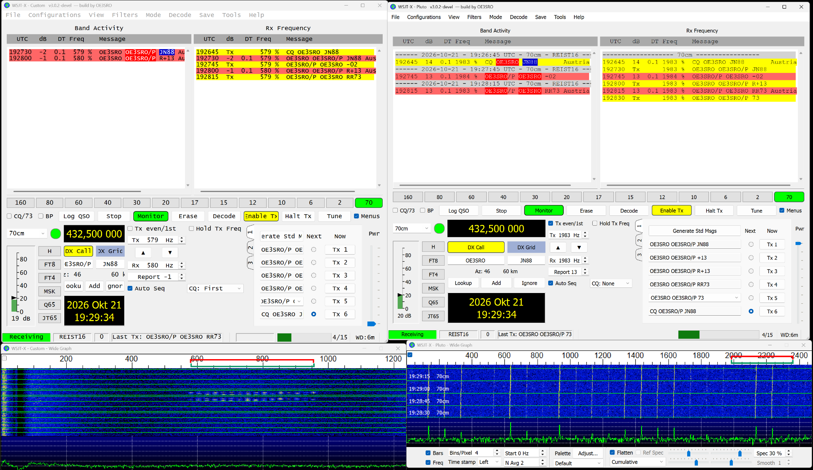

# REIST16 — experimentelle Betriebsart / experimental mode

**build by OE3SRO · Stand / updated: 2026-10-24 · Release 3.0.2-oe3sro.5**

[Deutsch](../README.md) · [English](../README.en.md) · [Profilvertrag / protocol](REIST16.txt) · [Pluto](PLUTO-WSJTX.txt)

## Was ist REIST16? / What is REIST16?

REIST16 ist OE3SROs experimentelle Betriebsart für kurze strukturierte
Amateurfunkgespräche in WSJT-X. CQ, Locator, Rapport, R-Rapport, RR73 und 73
bilden den vertrauten QSO-Ablauf; Doppelklick und Auto Seq unterstützen
Auswahl und Antworten. Die Nachricht wird als Tonfolge über einen SSB-
Audioweg übertragen. Das aktuelle Format heißt **QSO/2** und ist im
[Windows-Release 3.0.2-oe3sro.5](../docs/releases/3.0.2-oe3sro.5.md) enthalten.
REIST16 verwendet die 77-Bit-Nachrichtenpackung und LDPC-Bausteine von WSJT-X,
hat aber eine eigene Modulation und Synchronisation. Es ist zu FT8 nicht
funkkompatibel. QSO/2 ersetzt den Faltungscode und die CRC32 des historischen
QSO/1 durch CRC14 und LDPC; die ältere Beschreibung weiter unten gilt nur
für QSO/1.

REIST16 is OE3SRO's experimental WSJT-X mode for short structured amateur-radio
contacts. CQ, locator, report, R-report, RR73 and 73 follow the familiar QSO
sequence, with double-click selection and Auto Seq. Messages travel as audio
tones through an SSB path. The current **QSO/2** format is included in
Windows release 3.0.2-oe3sro.5. It reuses WSJT-X's 77-bit message packing and
LDPC components, with its own modulation and synchronization; it is incompatible
with FT8 over the air. QSO/2 replaces QSO/1's convolutional code and CRC32 with
CRC14 and LDPC. The historical specification below applies only to QSO/1.

### Einstieg / Getting started

1. Das gesamte Windows-ZIP entpacken, **Start-WSJT-X.bat** starten und
   Rufzeichen, Locator, CAT sowie Audio in den Einstellungen einrichten.
2. Beide Systemuhren synchronisieren und **Mode → REIST16** wählen.
3. Eine gemeinsame USB-Frequenz vereinbaren; es gibt keine vorgegebene
   REIST16-Standardfrequenz. Die Stationen senden in entgegengesetzten
   15-s-Slots (`:00/:30` und `:15/:45`). Beide benötigen QSO/2.
4. Mit **Monitor** empfangen; den gewünschten CQ-/QSO-Text und Auto Seq
   prüfen, bevor **Enable Tx** die Aussendung freigibt.

Extract the complete ZIP, launch **Start-WSJT-X.bat** and configure station,
CAT and audio. Synchronize both clocks, select **Mode → REIST16**, agree on
a USB frequency and use opposite 15-second TX slots. There is no default
REIST16 calling frequency. Both endpoints need QSO/2. Use **Monitor** to
receive and check the intended message and Auto Seq before enabling TX.
Supported structured messages use pack77 types 1 and 2, including supported
`/P` and `/R` callsigns; free text, telemetry and special contest formats are
outside this profile. PSK Reporter spotting is disabled for REIST16.

## Aktueller Stand: QSO/2

Dieser Build sendet **QSO/2**: 12,8 s Signalzeit, 15-s-UTC-Slots, 16-GFSK,
5 Hz Tonabstand, 77 Informationsbits und LDPC(174,91) mit CRC14.
Beide Gegenstellen benötigen das Update. Der neue Empfänger erkennt auch
QSO/1. [Neuer Profilvertrag, Messbedingungen und Grenzen](REIST16-QSO2.md).

This build transmits **QSO/2**, a 12.8 s LDPC-protected message within the
existing 15-second mode. Both endpoints need the update; the new receiver
also accepts QSO/1. [Protocol and measurement notes](REIST16-QSO2.md).

Browser-WebSDR-Empfang über WASAPI ist mit Yaesu-Senden in einer Instanz
möglich: `start-yaesu-websdr.bat`. `start-reist16-selftest.bat` ergänzt einen
eigenen reinen Empfänger für den Empfang der eigenen Aussendung. Nur der
explizite reine Empfangsmodus (`--receive-only`) erfasst jetzt bis 14,400 s;
der Sende-/Empfangsbetrieb behält 13,824 s für das Antwortbudget.
Im verzögerten Rauschtest gelangen damit 6/6 statt 0/6 Decodes. Das ist
Verzögerungstoleranz, kein belegter zusätzlicher dB-Gewinn. Die untersuchte
CQ-Mittelung ist noch nicht im Decoder enthalten. [WebSDR-Anleitung](WEBSDR-WSJTX.txt).

WASAPI browser reception and Yaesu transmission can share one instance via
`start-yaesu-websdr.bat`. The self-test launcher adds a dedicated receiver.
Only explicit receive-only operation now captures through 14.400 s;
transceive operation retains 13.824 s to preserve the reply budget.
The delayed noisy-frame test achieved 6/6 instead of 0/6 decodes. This
demonstrates delay tolerance, not an additional measured dB gain.
Experimental repeated-CQ averaging is not part of the shipped decoder.

Die folgenden Angaben und das QSO-Bild dokumentieren QSO/1 vom 21. Oktober.
The following specification and RF screenshot document the earlier QSO/1.

## Deutsch — QSO/1 (historisch)

REIST16 ist eine neue, experimentelle CQ-/QSO-Betriebsart dieses WSJT-X-Forks.
Sie verwendet feste 15-Sekunden-UTC-Slots und den vertrauten Ablauf mit CQ,
Locator, Rapport, R-Rapport, RR73 und 73. **Mode → REIST16** wählt den Modus;
Doppelklick und Auto Seq übernehmen die Gegenstelle und die Gegenperiode.
FT8, FT4 und FT2 bleiben verfügbar. REIST16 ist ein eigenes Funkprotokoll und
kann nicht mit FT8-Gegenstellen kommunizieren.

Die 77-Bit-Standardnachrichtenpackung stammt aus WSJT-X. Der Kanalcode folgt
dem Weak16-/CFP2-Ansatz aus SDR-suite; der native Empfänger verarbeitet die
12-kHz-Slotaufnahmen von WSJT-X. Dieses erste Profil akzeptiert pack77-Typen
1 und 2 einschließlich unterstützter `/P`- und `/R`-Rufzeichen. Freitext,
Telemetrie, Contest- und Fox/Hound-Formate sind nicht Teil dieses Profils.

| Parameter | REIST16-QSO/1 |
| --- | --- |
| UTC-Slot / nomineller Start | 15 s / Slotbeginn +0,500 s |
| Modulation | 16-FSK, ein aktiver Ton, stetige Phase |
| Symbolzeit / Tonabstand | 80 ms / 25 Hz |
| Äußere Tonmitten | 375 Hz Abstand; keine gemessene belegte Bandbreite |
| Rahmen | 120 Symbole, 9,60 s; davon 118 aktive Symbole, 9,44 s |
| Nutzlast | 77 gepackte Bits in zehn Bytes |
| Fehlerschutz | K7-Faltungscode, Rate 1/2, Interleaver, CRC32 |
| Profilkennung | RSQ1, `0x31515352`; keine WTX1-Flow-Kompatibilität |
| Audio | TX 48 kHz, RX 12 kHz |

Die vollständige Bitreihenfolge, Trainingsfolge, Rahmenstruktur und Fristen
stehen im [Profilvertrag](REIST16.txt). Es ist keine Standardfunkfrequenz
eingetragen. Beide Stationen vereinbaren die Frequenz und verwenden
entgegengesetzte TX-Slots: `:00/:30` und `:15/:45`. Die Audiofrequenz bezeichnet
den untersten Ton; der oberste liegt 375 Hz darüber.

### Yaesu-/Pluto-Funktionsnachweis

Der Benutzer-Screenshot vom **21. Oktober 2026** zeigt zwei Instanzen auf
**432,500 MHz**, links Yaesu FT-991A als **OE3SRO**, rechts PlutoSDR als
**OE3SRO/P**. Die Yaesu verwendet USB-Audio; Pluto ist über die lokale
TCI-Bridge als Funkgerät mit Frequenzsteuerung, PTT und Audio angebunden.
Virtuelle Audiokabel oder ein zusätzlicher SDR-suite-Codec-Flow sind dafür
nicht erforderlich. Eigene Stationsrufzeichen und DX Call bleiben getrennt:
Yaesu hat DX Call `OE3SRO/P`, Pluto hat DX Call `OE3SRO`.

| UTC | Sender | Nachricht | Bestätigung im Screenshot |
| --- | --- | --- | --- |
| 19:26:45 | Yaesu | `CQ OE3SRO JN88` | Pluto dekodiert, +14 dB |
| 19:27:30 | Pluto | `OE3SRO OE3SRO/P JN88` | Yaesu dekodiert, −2 dB |
| 19:27:45 | Yaesu | `OE3SRO/P OE3SRO -02` | Pluto dekodiert, +13 dB |
| 19:28:00 | Pluto | `OE3SRO OE3SRO/P R+13` | Yaesu dekodiert, −1 dB |
| 19:28:15 | Yaesu | `OE3SRO/P OE3SRO RR73` | Pluto dekodiert, +13 dB |
| 19:28:30 | Pluto | `OE3SRO OE3SRO/P 73` | TX bestätigt; letzter 73-Empfang links nicht sichtbar |

Der Nachweis belegt beidseitige native Dekodierung und QSO-Fortschritt mit
Auto Seq bis RR73, gefolgt vom 73-Senden. Ein Logbucheintrag ist nicht belegt.
Die angezeigten DT-Werte liegen bei 0,1 s. Die unterschiedlichen Audiofrequenzen
(etwa 580 bzw. 1983 Hz) sind im Bild sichtbar; beide Dialanzeigen stehen auf
derselben Frequenz. Der genaue Ursprung dieses relativen Versatzes ist damit
nicht isoliert. Der Benutzer meldete TxGain −89 dB als funktionierenden
Pluto-Wert. Das ist eine Geräteeinstellung dieses Aufbaus, keine kalibrierte
Sendeleistung, keine SNR-Angabe und keine allgemeine Einstellungsempfehlung.

### Prüfungen und Grenzen

`tools/Test-Reist16.ps1` prüft native Rahmen, AWGN-Fälle, drei getrennte
gleichzeitige Stationen, negative Kontrollen, sechs Standardnachrichten,
Produktions-PCM, Rufzeichenidentitäten und den Shared-Memory-Decoderprozess.
`tools/Test-PlutoBridge.ps1` prüft DSP, CAT/PTT, Profilbestand, Watchdog und
IIO-Fehlerpfade ohne Hardware. TX verwendet vier 40-ms-Kernelpuffer, RX
weiterhin 10-ms-Blöcke. Vollständige Rufzeichen verhindern die Verwechslung
von `OE3SRO` und `OE3SRO/P` beim Antworten.

Vor der Pufferänderung scheiterten zwei erfasste Pluto-CQs unverändert am
Decoder; nach einer zeitlichen Verkürzung um ungefähr ein Prozent dekodierten
sie korrekt. Das belegt eine Zeitverzerrung im Gesamtweg. Der nachfolgende
Screenshot zeigt funktionierende Übertragung; eine quantitative erneute
Vermessung der Restverzerrung liegt nicht vor. Aus diesen endlichen Tests
folgt weder eine Empfangsschwelle noch FT8-gleiche Empfindlichkeit.
Drift, Fading, überlappende Signale und Langzeitstabilität bleiben zu messen.
PSK-Reporter-Spots sind für REIST16 abgeschaltet; der lokale MODE-Wert ist
keine Behauptung einer registrierten ADIF-Betriebsart.

## English — QSO/1 (historical)

REIST16 is this fork's new **experimental** CQ/QSO mode. Select **Mode →
REIST16** for fixed 15-second UTC slots, standard structured messages,
double-click selection and Auto Seq. It is a separate over-the-air protocol,
incompatible with FT8. The mode combines WSJT-X's 77-bit message packing
(types 1 and 2) with Weak16/CFP2-derived framing, K7 rate-1/2 coding,
interleaving and CRC32. Sixteen tones at 25 Hz spacing and 80 ms per symbol
form a 9.60 s frame. The 375 Hz tone-centre span is not an occupied-bandwidth
measurement. See the [full profile contract](REIST16.txt).

The original screenshot above documents a user-operated **432.500 MHz**
Yaesu FT-991A / PlutoSDR test on **21 October 2026**. The left endpoint is
**OE3SRO**, the right endpoint **OE3SRO/P**. The exchange proceeds from CQ
through locator, report, R-report and RR73, all decoded at the opposite
endpoint, followed by a transmitted 73 from Pluto. Reception of that final
73 and a logbook entry are not visible. Yaesu reports −2/−1 dB; Pluto reports
+13/+14 dB, with displayed DT 0.1 s. These are decoder readings from this
setup, not a sensitivity measurement. The user's working TxGain −89 dB is
a device setting, not calibrated RF power or an SNR value. The relative
audio-frequency offset is visible but its origin has not been isolated.

The [local Pluto bridge](PLUTO-WSJTX.txt) carries frequency control, PTT and
audio over TCI without virtual audio cables. Four 40 ms TX buffers reduce
submission overhead and absorb short host stalls; RX retains 10 ms blocks.
Complete callsigns, including `/P` and `/R`, identify endpoints separately.
Before that buffering change, two captured CQs decoded only after offline
time compression of roughly one percent. The subsequent screenshot confirms
functional exchange, without a new quantitative residual-timing measurement.
Synthetic, production-audio and interface tests complement this RF example.
No FT8-equivalent sensitivity, fading/drift tolerance or general reliability
is claimed. REIST16 sends no PSK Reporter spots and does not claim a registered
ADIF mode. Existing FT8/FT4/FT2 modes remain available.
